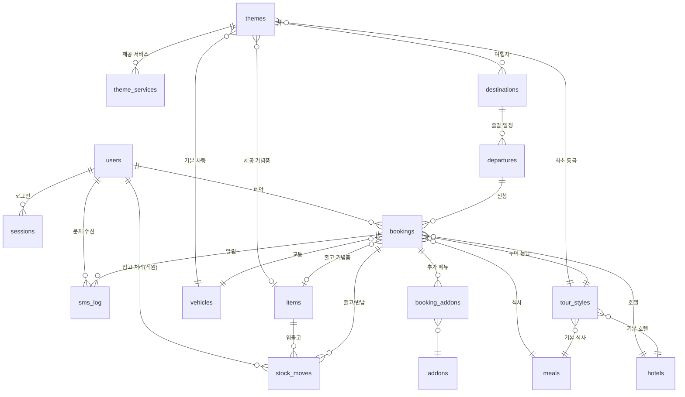

# 백엔드 · 데이터베이스 설계서

담당: 권석현 (백엔드 및 데이터베이스)
구성: Node.js + Express 4 + SQLite (Node 내장 `node:sqlite`)

## 1. 시스템 구성

```
[고객 브라우저: index.html] ─┐
                              ├─ HTTP/JSON ─> [Express 서버: server/index.js] ─> [SQLite: data/worldtour.db]
[직원 브라우저: staff.html] ──┘                  ├ routes/customer.js  (/api/...)
                                                ├ routes/staff.js     (/api/staff/..., 직원 권한)
                                                └ rules.js            (업무 규칙)
```

- 인증: 로그인 시 무작위 토큰을 `sessions` 테이블에 저장하고 `mw_sid` HttpOnly 쿠키로 전달 (7일 유효).
- 비밀번호: `scrypt` + 사용자별 salt로 해시 저장 (평문 저장 안 함).
- 예약·출발 확정·재고 변경은 하나의 트랜잭션으로 처리해 중간에 실패하면 모두 되돌립니다.

## 2. ERD



## 3. 테이블 정의서

전체 DDL은 [server/schema.sql](../server/schema.sql) 참고. 금액은 원 단위 정수, 날짜는 `YYYY-MM-DD` 문자열.

### users — 회원 (고객 · 직원)
| 컬럼 | 타입 | 제약 | 설명 |
| --- | --- | --- | --- |
| id | INTEGER | PK | 내부 번호 |
| login_id | TEXT | UNIQUE, 대소문자 무시 | 로그인 아이디 |
| pw_hash | TEXT | NOT NULL | scrypt 해시 (`salt:hash`) |
| name / address / phone | TEXT | NOT NULL | 성명, 주소, 연락처 (문자 수신) |
| role | TEXT | `customer` \| `staff` | 권한 |
| created_at | TEXT | | 가입 일시 |

### sessions — 로그인 세션
| 컬럼 | 타입 | 설명 |
| --- | --- | --- |
| token | TEXT PK | 쿠키 토큰 |
| user_id | INTEGER FK→users | |
| expires_at | TEXT | 만료일 |

### hotels / meals / vehicles / addons — 옵션 가격표
| 테이블 | 키 | 주요 컬럼 | 가격 기준 |
| --- | --- | --- | --- |
| hotels | grade (3·4·5) | name, price | 1인 1박 |
| meals | code (lunchbox·local·fine) | price, level, includes_champagne | 1인 1일 |
| vehicles | code (sedan·van·none) | capacity, price | 1일 (차량 1대) |
| addons | code (champagne·coffee) | price | 1인 1일 |

### tour_styles — 투어 등급
| 컬럼 | 설명 |
| --- | --- |
| code PK | classic / grand / premium |
| hotel_grade FK→hotels | 기본 호텔 (3/4/5성) |
| meal_code FK→meals | 기본 식사 (도시락/현지식/고급) |
| rank | 등급 비교용 (1·2·3) |

### items — 창고 물품 (기념품)
| 컬럼 | 설명 |
| --- | --- |
| id PK, code UNIQUE, name, unit | 물품 정보 (커플 기념티·건강 인삼 세트·골프공·스카프 …) |
| stock | 현재 재고 (`stock_moves` 합계와 항상 같음) |
| safety_stock | 안전 재고 — 이하로 내려가면 직원 화면에 입고 필요 알림 |

### themes — 테마 패키지
| 컬럼 | 설명 |
| --- | --- |
| code PK | honeymoon / parents / golf / trekking (직원이 추가 가능) |
| name, en, who | 상품명, 영문명, 동행 대상 |
| base_price | 1인 테마 패키지 가격 |
| min_style FK→tour_styles | 선택 가능한 최소 등급 (허니문·효도 = grand) |
| fixed_pax | 0 = 인원 자유, 2 = 2인 전용 (허니문) |
| max_pax | 최대 인원 (10인 승합 기준) |
| default_vehicle FK→vehicles | 테마 기본 차량 |
| confirm_unit | `team` (예약 건수) \| `person` (인원 합계) |
| confirm_min | 출발 확정 최소값 (허니문 2팀, 나머지 3명) |
| item_id FK→items, item_per_person | 제공 기념품과 1인당 수량 |
| active | 판매 여부 |

### theme_services — 테마별 제공 서비스 문구
### destinations — 테마별 여행지
| 컬럼 | 설명 |
| --- | --- |
| id PK, theme_code FK→themes, code | (theme_code, code) UNIQUE |
| name, region (`국내`·`해외`) | |
| extra_price | 1인 여행지 추가요금 |
| active | 판매 여부 |

### departures — 출발 일정
| 컬럼 | 설명 |
| --- | --- |
| id PK, destination_id FK | (destination_id, depart_date) UNIQUE |
| depart_date | 출발일 (매주 토요일 8주치 자동 생성 + 직원이 특별 출발 추가) |
| status | `open` 모집 중 · `confirmed` 출발 확정 · `closed` 운영 취소 |
| confirmed_at, memo | 확정 일시, 메모(취소 사유 등) |

### bookings — 예약
| 컬럼 | 설명 |
| --- | --- |
| id PK | `MW-YYMMDD-NNN` |
| user_id FK, departure_id FK | 예약자, 출발 일정 |
| nights, pax | 기간(박), 인원 |
| style_code, hotel_grade, meal_code, vehicle_code | 선택한 등급과 변경한 옵션 |
| subtotal, discount_rate, discount, total | 서버가 계산한 금액 (예약 시점 가격 보존) |
| status | `booked` · `cancelled` |
| item_id, items_allocated | 출발 확정 시 출고된 기념품과 수량 |
| pay_method, pay_info, pay_approval | 모의 결제 수단(card·transfer·easypay), 표시용 정보(카드는 끝 4자리만), 모의 승인번호 |
| paid_at, refunded_at | 결제 일시, 취소 시 환불 일시 |

### booking_addons — 예약별 추가 메뉴 (샴페인·커피)
### stock_moves — 재고 입출고 이력
| 컬럼 | 설명 |
| --- | --- |
| qty | +입고 / −출고 |
| kind | `in` 입고 · `out` 출발 확정 출고 · `return` 취소 반납 · `adjust` 조정 |
| booking_id, staff_id, memo | 관련 예약, 처리 직원, 메모 |

### sms_log — 문자 발송 기록 (시뮬레이션)
| 컬럼 | 설명 |
| --- | --- |
| user_id, phone, booking_id | 수신자, 번호, 관련 예약 |
| kind | `confirm` 출발 확정 · `closed` 운영 취소 |
| read_at | 고객이 화면에서 확인한 시각 (미확인 문자는 로그인 시 알림) |

## 4. 업무 규칙 (server/rules.js)

| 규칙 | 내용 |
| --- | --- |
| 가격 | 테마 기본가×인원 + 여행지 추가요금×인원 + 호텔가×박×인원 + 식사가×일×인원 + 차량가×일 + 추가 메뉴×일×인원. 할인액은 100원 단위 반올림 |
| 샴페인 | 샴페인 포함 식사(고급 레스토랑)를 고르면 샴페인 추가 메뉴는 과금하지 않음 |
| 등급 제한 | 선택 등급 rank ≥ 테마 최소 등급, 호텔 ≥ 최소 등급의 호텔, 식사 level ≥ 최소 등급의 식사 |
| 인원·차량 | 2인 전용 상품은 2명 고정, 차량 정원 < 인원이면 거절 |
| 예약 마감 | 출발 3일 전까지 |
| 출발 확정 | 예약·기준 변경 때마다 검사. `team`이면 예약 건수, `person`이면 인원 합계 ≥ confirm_min → status=confirmed, 예약자 전원 문자, 기념품 출고 |
| 확정 후 합류 | 이미 확정된 일정에 예약하면 그 예약만 바로 출고 + 확정 문자 |
| 취소 | 고객 본인(출발 전까지) 또는 직원. 출고된 기념품은 반납. 확정된 일정은 확정 유지 (이미 문자 발송·현지 예약 진행) |
| 운영 취소 | 직원이 일정을 취소하면 예약 전부 취소 + 반납 + 취소 문자 |
| 단골 할인 | 완료 여행(확정 + 여행 종료) 1–2회 우수 고객 5%, 3회 이상 단골 고객 10%. 예약 시점 등급으로 적용 |
| 예약 상태 | 예약 취소 / 출발 취소 / 출발 무산(인원 미달로 출발일 경과) / 모집 중 x/y / 출발 확정 / 여행 중 / 여행 완료 |
| 결제 | 결제 화면에서 결제(모의)해야 예약이 생성됨. 카드 번호는 서버로 보내지 않고 끝 4자리만 저장. 취소·운영 취소 시 환불 처리 |
| 가격 변경 | 화면 금액(`expectedTotal`)과 서버 계산이 다르면 409로 거절하고 새 금액 안내 |

## 5. API 명세

모든 요청·응답은 JSON. 오류는 `{ "error": "메시지" }` + HTTP 상태 코드 (400 입력 오류, 401 로그인 필요, 403 권한 없음, 404 없음, 409 가격 변경).

### 고객 API (`/api`)
| 메서드 | 경로 | 설명 | 로그인 |
| --- | --- | --- | --- |
| GET | /catalog | 판매 중인 테마·여행지·등급·옵션 가격표 | – |
| GET | /departures?theme=&dest= | 출발일별 신청 현황 `{date, status, count, teams, progress, min, unit, confirmed}` | – |
| POST | /quote | 견적 (로그인 시 할인 반영) | – |
| POST | /auth/signup | `{uid, upw, uname, uaddr, uphone}` 회원가입 + 로그인 | – |
| POST | /auth/login | `{uid, upw}` | – |
| POST | /auth/logout | | – |
| GET | /me | 현재 회원 + 등급 `{user: {id, name, address, phone, role, tier}}` | – |
| GET | /me/bookings | 내 예약·여행 내역 (출발일 최근 순) | 고객 |
| POST | /bookings | `{theme, dest, date, nights, pax, style, hotel, meal, vehicle, addons[], expectedTotal, payment: {method, last4?, installment?, bank?, agree}}` 모의 결제 + 예약 → `{booking, confirmedNow, sms[]}` | 고객 |
| POST | /bookings/:id/cancel | 예약 취소 | 고객 |
| GET | /me/sms?unread=1 | 받은 문자 | 고객 |
| POST | /me/sms/read | 문자 읽음 처리 | 고객 |

### 직원 API (`/api/staff`, staff 권한)
| 메서드 | 경로 | 설명 |
| --- | --- | --- |
| GET | /summary | 운영 현황 (예정 일정 수, 확정/모집 중, 인원, 매출, 임박 미확정 일정, 재고 부족) |
| GET | /departures?scope=&status=&theme=&booked=1 | 출발 일정 목록 |
| GET | /departures/:id | 출발 일정 상세 + 예약자 명단 |
| POST | /departures | `{theme, dest, date, memo}` 특별 출발일 추가 |
| POST | /departures/:id/close | `{memo}` 운영 취소 |
| POST | /bookings/:id/cancel | 예약 취소 대행 |
| GET | /themes | 상품 전체 (판매 중지 포함) + 선택지 |
| POST | /themes | 새 테마 상품 |
| PATCH | /themes/:code | 상품 수정 (확정 기준 변경 시 모집 중 일정 재검사) |
| POST | /themes/:code/destinations | 여행지 추가 |
| PATCH | /destinations/:id | 여행지 수정·판매 중지 |
| GET / PUT | /prices | 옵션 가격표 조회·수정 |
| GET | /items | 물품 목록 (재고, 출고 예정, 안전 재고) |
| POST | /items | 새 물품 등록 |
| PATCH | /items/:id | 물품 정보 수정 |
| POST | /items/:id/moves | `{kind: in\|adjust, qty, memo}` 입고·조정 |
| GET | /stock-moves?item= | 입출고 이력 |
| GET | /customers | 고객 목록 (등급, 예약 수, 누적 결제) |
| GET | /customers/:loginId/bookings | 고객 여행 내역 |
| GET | /sms | 문자 발송 기록 |
| POST | /reset | 데모 데이터 초기화 |

## 6. 테스트

`npm test` — `test/api.test.js` (node:test). 날짜를 2026-11-16으로 고정하고 메모리 DB에서 실행합니다.

| 테스트 | 검증 내용 |
| --- | --- |
| 카탈로그 | 4개 테마, 확정 기준(허니문 2팀, 그 외 3명) |
| 로그인·회원가입 | 비밀번호 오류 401, 단골 등급, 입력 검사, 중복 아이디 |
| 예약 검증 | 등급 제한, 호텔 하한, 2인 전용, 차량 정원, 예약 마감 |
| 가격 | 화면 금액 불일치 시 409 |
| 허니문 출발 확정 | 2팀 모이면 확정 + 양쪽 예약자 문자 + 커플티 4벌 출고 |
| 일반 테마 | 2명 모집 중, 3명 확정, 샴페인 중복 제외 |
| 취소 | 기념품 반납, 확정 유지, 타인 예약 취소 불가 |
| 이전 여행 목록 | 최근 순, 완료 3건 |
| 직원 권한 | 비로그인 401, 고객 403 |
| 재고 | 입고, 과다 조정 거절, 신규 물품 이력 |
| 상품 기획 | 확정 기준 변경 재검사, 여행지·출발일 추가가 고객 화면에 반영 |
| 운영 취소 | 예약 취소 + 문자 + 반납 |
| 모의 결제 | 결제 정보 검증, 승인번호·결제 수단 저장, 취소 시 환불, 카드 번호 전체 미저장 |
